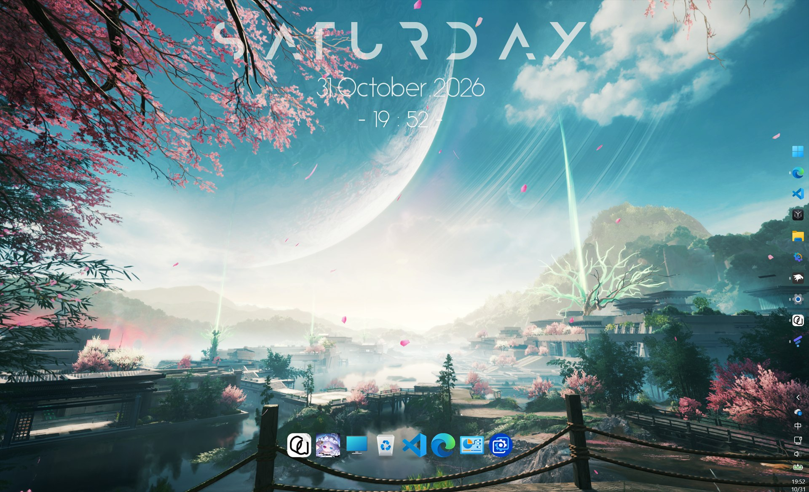

# Desktop Icon Dock / 桌面图标 Dock

把快捷方式、文件和文件夹拖进来，组成一个居中的 macOS 风格 Dock。Dock 是独立列表，不再镜像桌面内容，快捷方式会复制到 Dock 自己的目录，清理桌面不影响 Dock；默认使用完全透明的背景，只显示图标，也可以选择从透壳、毛玻璃、亚克力、云母、Aero 到液态玻璃和暗玻璃的 8 种背景风格。

*实际效果：图标以 macOS Dock 样式居中排列，悬停的图标会放大并显示名称。*

## 功能特性

- **拖入添加**：从桌面、资源管理器或 `shell:Desktop` 窗口把快捷方式、文件、文件夹拖到 Dock 上，插入到落点位置；已在 Dock 中的项目会被忽略。快捷方式（`.lnk` / `.url`）会复制到 Dock 自己的目录，删除桌面上的原快捷方式不影响 Dock；文件和文件夹按路径引用。
- **拖动排序**：按住图标在 Dock 内拖动，图标实时换位，松手后保存新顺序。
- **拖出放回桌面**：把图标拖到 Dock 面板外、在桌面上松手，图标会放在松手位置。项目原本就在桌面上时移动原图标；否则在桌面创建指向它的快捷方式，原文件或文件夹保持原位；复制进来的快捷方式会优先复用原快捷方式，不会产生多余的 `(2)` 副本；在其他窗口上松手则项目留在 Dock。回收站等虚拟项目仅从 Dock 移除；Dock 副本在放回桌面后删除。移除最后一项后回到空状态提示。
- **空状态提示**：列表为空时显示居中的半透明提示框，同时作为拖放目标，Dock 窗口不会因为列表为空而隐藏。
- **与桌面解耦**：桌面新增、删除、重命名或移动图标都不会影响 Dock；快捷方式使用 Dock 自己的副本，删除桌面原快捷方式也不受影响。列表按用户保存在 Windhawk 模组存储中，重启 Explorer 后顺序不变。
- **macOS 风格悬停放大**：鼠标接近时图标平滑放大，按余弦曲线衰减，相邻图标同时向外让位。
- **透明背景（默认）**：只绘制图标与柔和投影，完全融入壁纸；Dock 窗口的透明区域允许鼠标穿透，不会挡住桌面右键和点击。
- **8 种背景风格**：透明、透壳、毛玻璃、亚克力、云母、Aero、液态玻璃、暗玻璃。每种风格是一组调好的材质预设，拥有各自的模糊、色调、饱和度、噪点、边缘高光和镜面高光；背景从 Dock 上方的屏幕区域采样，支持 Wallpaper Engine 等动态壁纸。面板色调可强制浅色/深色，或自动跟随壁纸。
- **重建的液态玻璃**：在原有乳白模糊、顶部光泽和虹彩内边的基础上，加入根据背景明暗自动调整的色调、跟随鼠标的镜面高光，以及边缘折射/轻微色差。
- **名称标签**：悬停时在图标上方显示名称胶囊；透明背景下标签位置固定，不会随图标放大而跳动。
- **原生交互**：左键单击打开项目；右键弹出该项目的资源管理器原生菜单（打开、发送到、创建快捷方式、属性、删除等）。
- **在内存中隐藏原始桌面图标**：Dock 运行期间隐藏桌面的列表视图窗口，不修改 Explorer 的任何设置或注册表项；卸载模组后图标自动恢复，重启 Explorer 也不会留下影响。
- **按需加载图标并清理缓存**：图标按显示大小提取并按项目路径缓存，项目消失后清除对应缓存。

## 工作方式

Dock 不再读取或重排桌面图标，而是一个独立的项目列表：

- **存储**：列表保存在 Windhawk 模组存储中的 `items.tsv` 里，并按当前用户 SID 分目录，因此同一台机器的不同用户各自保留列表。顺序即显示顺序，每行是 `SIGDN_DESKTOPABSOLUTEPARSING` 解析名（例如 `C:\Users\Lenovo\Desktop\Foo.lnk`、`::{645FF040-5081-101B-9F08-00AA002F954E}`）以及复制型快捷方式的原始路径。快捷方式副本位于同一目录的 `Items` 子目录。每次添加、移除或重排后立即写入；卸载模组时 Windhawk 会删除整个存储目录。
- **解析**：通过 `SHCreateItemFromParsingName` 解析每个项目并提取名称和图标。解析失败的项目跳过显示但保留在存储中，不会自动删除；每 30 秒只重试此前失败的项目，并单独刷新回收站等虚拟项目的图标。
- **拖入**：窗口注册 OLE `IDropTarget`，支持 `CF_HDROP` 和 Shell IDList Array；`.lnk` / `.url` 会先复制到 Dock 目录，其它项目按原解析名保存；多项目按顺序插入，并按解析名去重。落点接受后 `Drop` 立即返回，复制和解析在 Dock 线程的消息里完成，慢速或不可达的路径不会冻结拖拽源。
- **拖出**：仅在松手点位于面板外且落在桌面上时生效，通过桌面文件夹视图把项目放到该位置；落在其他窗口上则项目留在 Dock。父目录已是用户桌面或公共桌面的项目直接移动原图标，复制型快捷方式优先使用记录的原始快捷方式；其它文件/文件夹在用户桌面创建唯一命名的 `.lnk` 快捷方式（源是 `.lnk` / `.url` 时复制，其余新建），不移动也不删除原文件；Dock 副本在放回桌面后删除。定位遵循系统的「对齐到网格」设置。
- **布局**：水平居中于主显示器底部、任务栏上方；图标增多时面板自动变宽，静止时图标垂直居中。
- **性能**：透明背景模式下用 50ms 间隔轮询鼠标位置，以支持图标间隙的悬停放大；空闲时 CPU 占用可忽略。面板风格按各自的预设做模糊和颜色处理，透明风格不做背景采样。

## 背景风格

| 风格 | 特点 |
| --- | --- |
| 透明 | 不绘制面板，只有图标与投影；最贴近壁纸，透明像素点击穿透 |
| 透壳 | 很薄的半透明填充 + 亮边，不做模糊；像一块透明壳，成本最低 |
| 毛玻璃 | 均匀模糊 + 轻乳白色调 + 细腻噪点；最稳妥、通用的玻璃质感 |
| 亚克力 | 更强模糊、更高饱和、颗粒和较厚色调；接近 Windows 弹出层的磨砂材质 |
| 云母 | 壁纸着色、低饱和、接近不透明；安静、省性能，适合长时间常驻 |
| Aero 玻璃 | 强高光、亮边、外发光和更强的饱和；Windows 7 风格的立体玻璃 |
| 液态玻璃 | 乳白模糊 + 镜面高光 + 虹彩内边 + 边缘折射；会根据背景明暗调整色调 |
| 暗玻璃 | 高暗度、深模糊、细亮边和内阴影；在明亮或复杂壁纸上最稳 |

## 设置说明

| 设置 | 默认值 | 说明 |
| --- | --- | --- |
| 图标大小 | 48 | 100% DPI 下的基础像素大小，随系统缩放自动放大（150% 时约 72px） |
| 图标间距 | 10 | 静止时图标之间的像素间距 |
| 最大放大比例 | 175% | 悬停图标的最大倍数 |
| 效果半径 | 160 | 放大效果从光标向外衰减的距离（像素） |
| 相邻扩散 | 60% | 放大时相邻图标向外让位的程度 |
| 平滑速度 | 16 | 数值越大越跟手，越小越柔和 |
| 底部偏移 | 10 | Dock 与任务栏之间的间距（100% DPI 像素） |
| 背景风格 | 透明 | 透明、透壳、毛玻璃、亚克力、云母、Aero、液态玻璃、暗玻璃 |
| 面板色调 | 自动 | 浅色、深色或自动跟随 Dock 后方的壁纸；透明风格忽略此项，暗玻璃始终保持深色 |
| 显示名称 | 开 | 悬停时显示名称胶囊 |
| 隐藏原始桌面图标 | 关 | 在内存中隐藏桌面列表视图，不修改系统设置；卸载时恢复。默认关闭，便于从桌面拖入项目 |
| 背景刷新间隔 | 20 秒 | 重新采样面板模糊背景的间隔，0 表示不自动刷新 |

## 兼容性与限制

- 仅支持 x86-64 的 Windows 10 / 11，以 Windhawk tool mod 的独立 explorer.exe 进程运行，与正在运行的 Shell 进程分离（Windhawk 主程序为 32 位，无法承载本 x86-64 模组），且只在主显示器底部显示。
- 目前仅支持主显示器；Dock 固定在主显示器底部、任务栏上方。
- Dock 是位于普通窗口下方的分层窗口：全屏应用或其它窗口会盖住它，这是预期行为。
- 透明背景模式下，窗口透明像素点击穿透；外部拖入时请把鼠标落在图标或空状态提示上，拖入后 Dock 会临时绘制一层浅色拖放区域，图标之间的间隙也可以接收落点。
- 快捷方式会复制到 Windhawk 模组存储目录并独立存在；普通文件和文件夹仍按路径引用，源文件被删除或改名后对应图标会隐藏，但记录会保留。
- 不支持开始菜单磁贴、UWP 应用等无法作为文件系统项目拖拽的来源。

## 故障排查

- **首次启动没有图标**：Dock 默认是空列表，这是预期行为；把快捷方式、文件或文件夹拖到提示框上即可添加。
- **Explorer 重启**：Dock 运行在独立的 explorer.exe tool-mod 进程中，Shell 重启不会将它卸载；它会重新连接新的桌面视图并重新应用桌面图标的隐藏。
- **某个项目不见了**：它的解析名已失效（例如引用的文件或文件夹被删除、改名）。快捷方式使用 Dock 自己的副本，删除桌面原快捷方式不受影响。条目会保留在存储中并定期重试，路径恢复后会重新出现。
- **拖出后桌面上多了一个快捷方式**：这是预期行为。不在桌面上的项目不会被移动，而是在松手位置创建快捷方式；原文件不受影响，快捷方式可随时删除。若原本就是桌面上复制进来的快捷方式，会直接复用原快捷方式而不会重复创建。
- **想清空列表**：在 Dock 内把项目逐个拖出，或卸载模组；Windhawk 会连同快捷方式副本一起删除该模组的存储。
- **修改设置后未生效**：保存设置即自动重载并重建，无需重启 Explorer。

## 与现有模组的区别

本模组与 Quick Launch Dock 在基础启动器行为上有重叠（拖入、排序、点击启动、持久列表），但目标是「桌面的一部分」而不是常驻在其他窗口之上的启动器：

- **桌面层级**：窗口位于 Z 序最底部、所有普通窗口之下，且从不获取焦点，只在桌面可见时可见。
- **拖出回桌面**：可以把项目从 Dock 拖回桌面，并优先复用仍在桌面上的原快捷方式，不会产生重复副本。
- **桌面集成**：在内存中隐藏系统桌面图标、打开资源管理器原生右键菜单，都通过 Shell 桌面视图完成；模组本身运行在独立的 explorer.exe tool-mod 进程中，不注入正在运行的 Shell 进程。
- **屏幕采样玻璃**：玻璃背景采样 Dock 上方的屏幕区域，这需要桌面层级窗口；名称胶囊使用与当前面板风格一致的色调。

## 源码

`desktop-icon-dock.wh.cpp` 是本模组的 Windhawk 源码，也可直接在 Windhawk 中作为本地模组加载。
